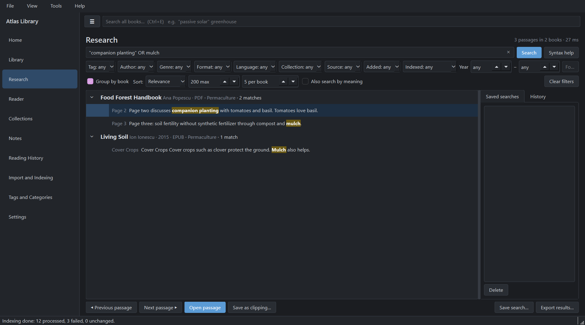
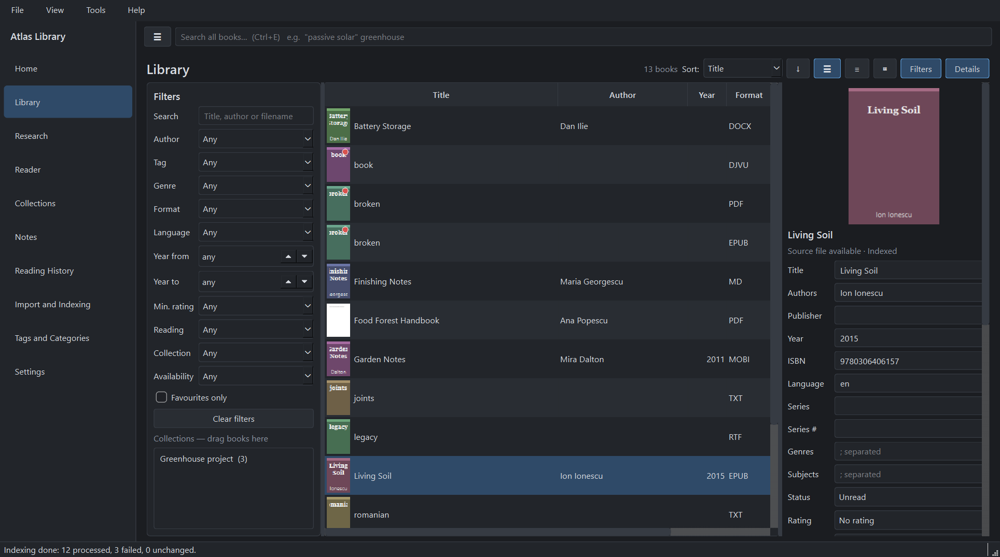
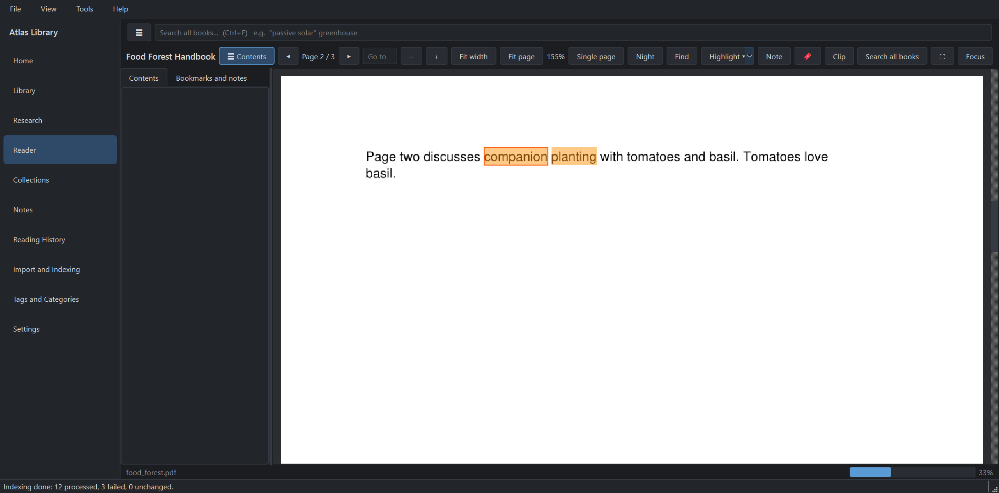
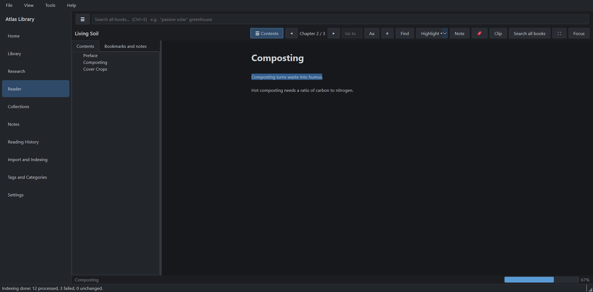

# Atlas Library

A local ebook library and research workstation for Windows 10/11. Import folders of PDF, EPUB, MOBI, TXT, Markdown, HTML, DOCX and RTF files; search every word across the whole library (offline, SQLite FTS5); read in the built-in readers; save passages as research clippings and organise them in a notebook. No account, subscription, cloud or AI service is needed.



* **Your books are never moved or modified.** Atlas keeps its own database in `%LOCALAPPDATA%\AtlasLibrary` (never next to the executable).
* **External drive unplugged?** Book records, tags, annotations, clippings, notes and reading progress stay available; books reconnect when the drive returns (even under a different drive letter).
* **Research mode:** phrases, `AND` / `OR` / `NOT`, prefixes, filters by tag/author/year/format/collection/folder, results grouped by book with the exact PDF page or EPUB chapter, one click to open the passage in the reader, save it as a clipping with its source.

| Library | Reader (PDF) | Reader (EPUB) |
|---|---|---|
|  |  |  |

(The screenshots use a small synthetic test collection.)

## Install and run

Download from the [Releases](../../releases) page:
* **`AtlasLibrary-Setup-<version>.exe`** – installer (per-user by default, no admin rights needed), or
* **`AtlasLibrary-<version>-portable.zip`** – unzip anywhere and run `AtlasLibrary.exe`.

Both are unsigned, so Windows SmartScreen may warn on first start (*More info → Run anyway*). The first-run wizard asks for your books folder, an optional second folder/USB drive, the data location, and whether to index now (you can postpone).

**From source** (Python 3.12+):

```powershell
python -m venv .venv
.\.venv\Scripts\python -m pip install -r requirements-dev.txt
.\.venv\Scripts\python -m atlas
```

**Build the Windows executable and installer:** `.\build.ps1` (installs dependencies, runs the tests, builds with PyInstaller, writes `dist\AtlasLibrary-<version>-portable.zip`, and the installer when Inno Setup 6 is installed; `-Pfx <file>` signs with your certificate, see `build_tools/sign.ps1`). Verify a build with `AtlasLibrary.exe --selftest result.txt`.

**Tests:** `.\.venv\Scripts\python -m pytest -q` · **Benchmark:** `python scripts\benchmark.py 2000` (prints measured numbers).

## Using it

| Screen | What it does |
|---|---|
| Home | continue reading, recent books/notes/annotations, favourites, popular tags, statistics, indexing and offline-source status (sections configurable in Settings) |
| Library | list / compact / cover-grid views, sorting, combined filters, bulk edit, tags, collections (drag books onto them), favourites, status badges, open in Explorer, copy path, metadata editor, table of contents |
| Research | full-text search with filters, passage navigation, saved searches, history (the last query is remembered), clippings, export (Markdown / HTML / CSV), optional search by meaning — see [docs/SEARCH_SYNTAX.md](docs/SEARCH_SYNTAX.md) |
| Reader | PDF (continuous/single page, zoom, fit, text selection, highlights, find, TOC) and reflowable reader (EPUB, MOBI, HTML, …: fonts, spacing, width, light/sepia/dark, scroll or paged, bookmarks, highlights, notes); resumes where you stopped |
| Collections | virtual shelves, duplicate inspector (never deletes), metadata review with "fill from file names" (preview, empty fields only) |
| Notes | research topics (Markdown, `[[links]]`, backlinks, linked books and passages), clippings, all annotations |
| Reading History | what you read, progress, time spent |
| Import and Indexing | sources, scan/rescan/resume/cancel, progress counters, failed/encrypted/unsupported/scanned files, retry, OCR, index check and repair |
| Tags and Categories | nested tags (drag to move), merge/rename/delete, auto-tag rules that only *suggest* until you confirm |
| Settings | locations, readers, search, indexing exclusions and schedule, OCR, backups, optional online metadata lookup, semantic search |

Shortcuts: `Ctrl+E` global search · `Ctrl+1…0` screens · `Ctrl+B` sidebar · `Ctrl+F` find in book · `Ctrl+D` bookmark · `Ctrl+K` clip selection · `Alt+←/→` page/chapter · `F11` full screen · `Ctrl+Shift+F` distraction-free · `Esc` leave.

## Formats

PDF, EPUB, MOBI/PRC/AZW (unencrypted MOBI6; AZW3/KF8 best-effort), TXT, Markdown, HTML, DOCX, RTF. DRM-protected, password-protected and unsupported files are reported, never bypassed. DjVu and legacy `.doc` are not supported. Scanned PDFs can be OCR'd with an installed Tesseract (optional).

## Where data lives, backups, updates
See [docs/BACKUP_AND_RESTORE.md](docs/BACKUP_AND_RESTORE.md). In short: the installation folder holds only the program; `%LOCALAPPDATA%\AtlasLibrary` holds `settings.json`, `db\atlas.db` (irreplaceable), `db\index.db` (rebuildable), `cache`, `ocr`, `logs`, `backups`; **your books are backed up by you, separately.** To update, install the new version over the old one; the database migrates automatically.

## More documentation
[Architecture and deviations](docs/ARCHITECTURE.md) · [Troubleshooting](docs/TROUBLESHOOTING.md) · [Semantic search](docs/SEMANTIC_SEARCH.md) · [Project status and known limitations](STATUS.md) · [Changelog](CHANGELOG.md) · [Release checklist](docs/RELEASE_CHECKLIST.md)

## Licensing note
No license file has been chosen yet. The application depends on **PyMuPDF (AGPL-3.0 / commercial)** and **PySide6 (LGPL-3.0)**, among others; anyone redistributing builds should review those licenses and pick a compatible license for this project.
